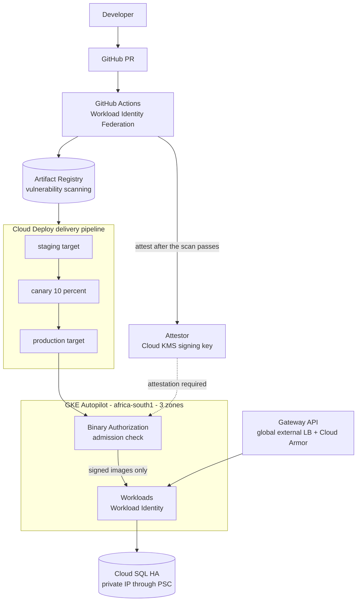
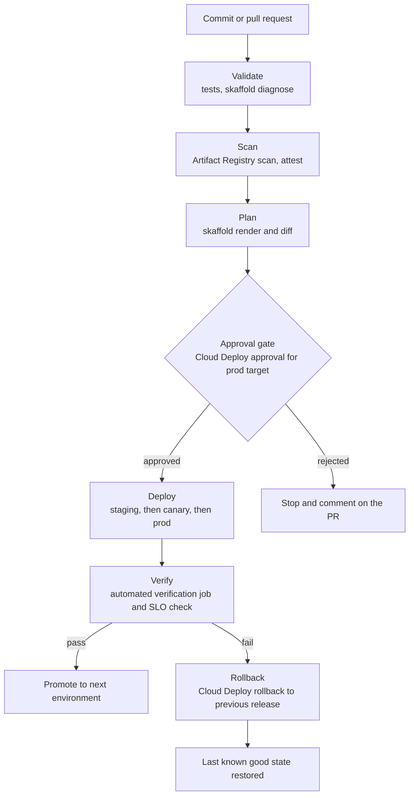
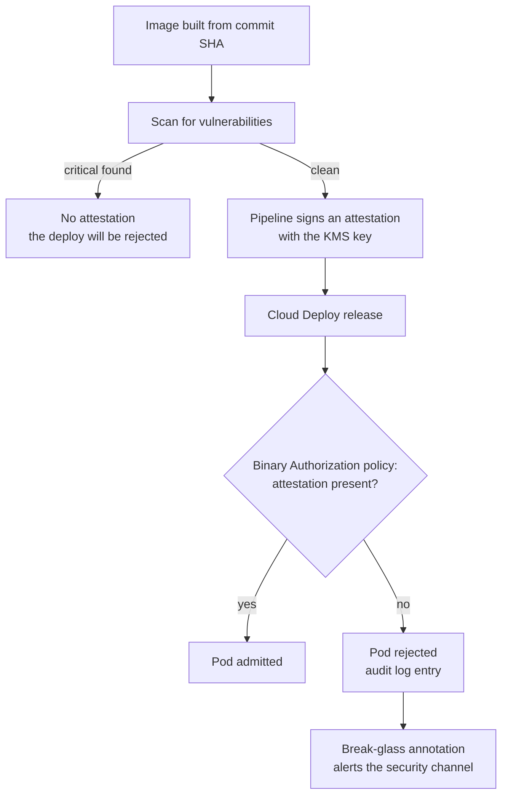

# GKE Supply-Chain Platform

A GKE Autopilot and Cloud Run platform where only images built and attested by your pipeline are allowed to run, released through staged Cloud Deploy pipelines.

### Business use case

A South African fintech or government-technology vendor is asked by customers to prove what code runs in production and who approved it. Binary Authorization turns that proof into a control instead of a document.

### The hard piece

Binary Authorization with progressive delivery

### Rough monthly cost, ZAR

R300 to R1,500 a month. Cloud Run scales to zero, and GKE has a monthly credit that covers the management fee of one cluster, which is worth verifying on your billing account. Delete the cluster after sessions.

### Tool stack

- GKE Autopilot
- GKE Standard with Spot pool (variant)
- Cloud Run
- Artifact Registry + vulnerability scanning
- GitHub Actions + Workload Identity Federation
- Cloud Deploy + Skaffold
- Binary Authorization + attestors (Cloud KMS)
- Config Sync or Argo CD
- Gateway API + global load balancer
- Cloud Armor
- Secret Manager
- Cloud SQL (HA) + Private Service Connect
- Managed Prometheus
- Cloud Monitoring SLOs
- Terraform

### Diagrams

#### Diagram 1 · Architecture: pipeline, attestation and cluster

> **How to read this:** An image only reaches the cluster after two things happen: the scan passes, and the pipeline signs an attestation with a key your developers cannot touch. Cloud Deploy walks the release from staging to a canary to production. At the cluster, Binary Authorization checks the signature, and anything unsigned is rejected.

#### Diagram 2 · CI/CD: build, attest, staged release

> **How to read this:** Follow the top line from a commit to a deploy: the pipeline stops at the first red step, and nothing reaches the approval gate unless validation, scanning and the plan all passed. The bottom branch is the one hiring managers ask about: when verification fails, the rollback box puts the environment back without a human editing the console.

#### Diagram 3 · Hard piece: the attestation path

> **How to read this:** The control is the diamond: the cluster refuses to run an image that has no attestation, no matter who tries to deploy it. The break-glass path exists but is loud, because it alerts the security channel.

### How it covers the five focus areas

- **Compute · HOME**: Autopilot with right-sized requests (you pay for requests), a Standard cluster with a Spot node pool as a variant, Cloud Run scaling to zero, HPA and VPA, topology spread across three zones.
- **Networking** (deep): Gateway API with a global external load balancer, Cloud Armor, private cluster with authorized networks, Private Service Connect to Cloud SQL, Cloud NAT.
- **Storage** (deep): Cloud SQL regional HA with point-in-time recovery, GCS with versioning, Backup for GKE.
- **CI/CD · HOME**: Federated identity, scan, attest, Cloud Deploy targets with approvals and canary, automated verification, rollback.
- **Cost optimisation** (deep): Autopilot request tuning, Spot pool, Cloud Run min instances at zero, Recommender review, committed use discount analysis for the steady baseline.
### Advanced features that show depth

- Build, SBOM, scan, attest and enforce, end to end
- Cloud Deploy canary with an automated verify step tied to an SLO
- A break-glass annotation that is audited and alerts security
- Fleet-style config with Config Sync across a nonprod and a prod cluster
- A comparison page: the same service on Autopilot and on Cloud Run, with cost and latency

### Production-like touches

- Dev, staging and prod targets with approvals
- SLO alerts using burn rate
- Runbook: roll back a release, and runbook: rotate the attestor key
- Post-incident write-up: an unsigned image was rejected during a hotfix
- A short architecture decision record on Autopilot versus Standard

### AWS to GCP bridge

| AWS | Google Cloud | Where it differs |
| --- | --- | --- |
| EKS | GKE | Autopilot removes node management. The closest AWS comparison is EKS Auto Mode or Fargate. |
| ECR | Artifact Registry | Scoped per project, in a region or multi-region. |
| CodeDeploy | Cloud Deploy | Delivery pipelines with targets, approvals and rollback. |
| IRSA | Workload Identity | Map a Kubernetes service account to a Google service account without keys. |
| ALB | Gateway API + global external load balancer | One global anycast IP and global scale, not a regional load balancer. |
| Fargate | Cloud Run | Scales to zero and bills per request time. |

### Résumé pitch

- Built a GKE and Cloud Run platform where only attested images run, blocking \[N\] unsigned or vulnerable deployments in testing.
- Implemented Cloud Deploy staged releases with automated verification, cutting rollback time to \[N\] minutes.
- Reduced workload cost by \[N\]% by right-sizing Autopilot requests and using Spot capacity.

> *Replace every \[N\] with a number you measured. If you cannot measure it, remove the claim.*
